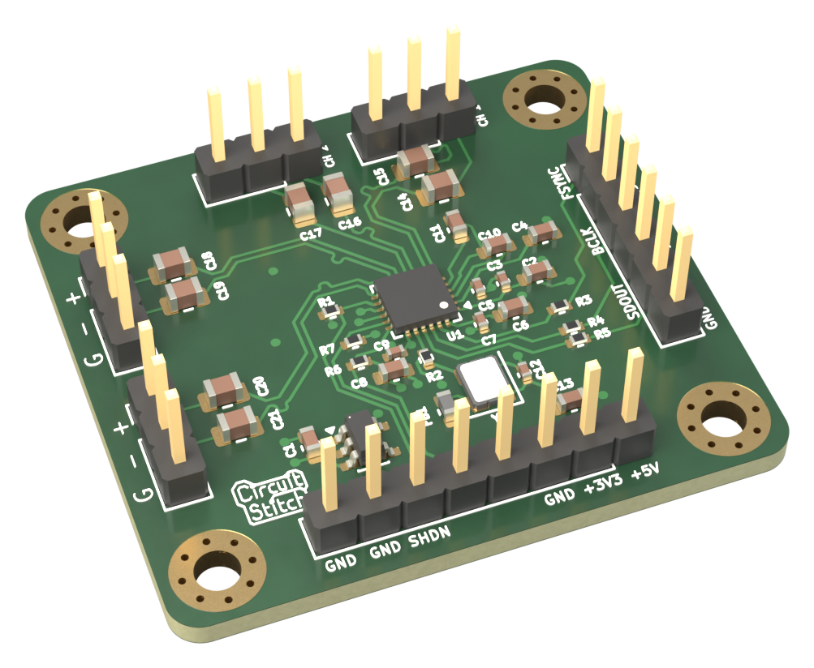
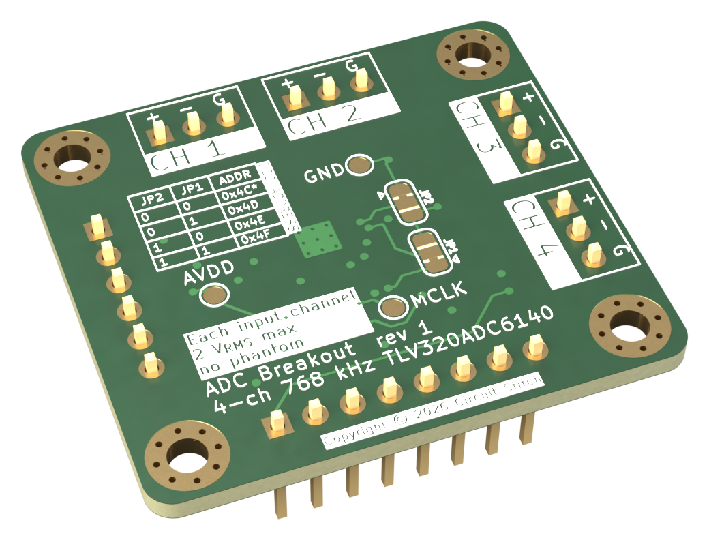

# ADC breakout

A four-channel, line-level ADC board built around the TI TLV320ADC6140. It is a KiCad 10 project.

The board sends TDM audio out and is controlled over I2C. It connects to a Raspberry Pi Pico 2 by jumper wires. It was built as the real ADC for the RP2350 capture tests in portacorder, a portable 32-bit float recorder.

The parts and reference designators match `docs/bom.md`.

| Front | Back |
|-------|------|
|  |  |

## Files

- `adc-breakout.kicad_pro` is the project. Open it in KiCad.
- `adc-breakout.kicad_sch` is the schematic.
- `adc-breakout.kicad_pcb` is the 4-layer PCB.
- `adc-breakout.pdf` is a PDF export of the schematic.
- `pfr.kicad_sym` is the project symbol library. It holds the TLV320ADC6140 symbol. KiCad has no stock symbol for this part.
- `sym-lib-table` adds `pfr.kicad_sym` to the project.
- `gerbers/version 1/` holds the rev 1 fabrication files. `gerbers/version 1.zip` is the same set, zipped for upload.
- `jlcpcb/` holds the JLCPCB assembly BOM and placement (CPL) files for rev 1.
- `pcbway/` holds a PCBWay assembly BOM, with manufacturer part numbers, and a centroid file. These have not been used for an order.
- `docs/bom.md` is the bill of materials, with prices, stock, and part notes.
- `docs/oscillator-selection.md` compares the 24.576 MHz oscillators considered for Y1 and for portacorder Rev A.
- `renders/` holds the front and back board renders and a STEP model of the assembled board.
- `datasheets/tlv320adc6140.pdf` is the ADC datasheet.
- `datasheets/ASTX-H11.pdf` is the Y1 oscillator datasheet.
- The other files in `datasheets/` are the oscillator datasheets cited in `docs/oscillator-selection.md`.

All other symbols and footprints come from the stock KiCad 10 libraries.

## Headers

| Header | Pins |
|--------|------|
| J1, power and control | 1 +5V, 2 +3V3, 3 GND, 4 SDA, 5 SCL, 6 SHDNZ, 7 GND, 8 GND |
| J2, audio bus | 1 FSYNC, 2 GND, 3 BCLK, 4 GND, 5 SDOUT, 6 GND |
| J3–J6, line inputs CH1–CH4 | 1 CHx_IN_J+ (tip), 2 CHx_IN_J- (ring), 3 GND (sleeve) |

Each input is balanced line level, wired straight to the ADC through its coupling caps. The ADC clips at about 2 Vrms differential, about +8 dBu. There is no phantom power and no phantom protection.

The ADC side of each coupling cap is `CHx_IN+` or `CHx_IN-`. Each `+`/`-` pair routes as a differential pair in the PCB editor.

## Changes from the BOM

C10 and C11 ground to GND. Route each ground terminal straight to U1 pin 4 (AVSS), with no via, as the datasheet layout guidelines require.

JP1 and JP2 are 3-pad solder jumpers. The BOM lists 2-pad jumpers. Pads 1–2 are bridged to GND by default, which gives I2C address 0x4C. To change the address, cut 1–2 and bridge 2–3 to IOVDD. A cut 2-pad jumper would leave the address pin floating.

## Footprint checks

- Y1 uses the stock Abracon ASE footprint for 3.2 × 2.5 mm oscillators. Check its pads against the ASTX-H11 datasheet, `datasheets/ASTX-H11.pdf`.
- U1 uses the TI RTW footprint with thermal vias, `Texas_RTW_WQFN-24-1EP_4x4mm_P0.5mm_EP2.7x2.7mm_ThermalVias`. The thermal pad is pin 25.

## License

The design is licensed under the CERN Open Hardware Licence Version 2 – Weakly Reciprocal (CERN-OHL-W-2.0). See `LICENSE`.

The PDFs in `datasheets/` belong to their manufacturers. The license does not cover them.
